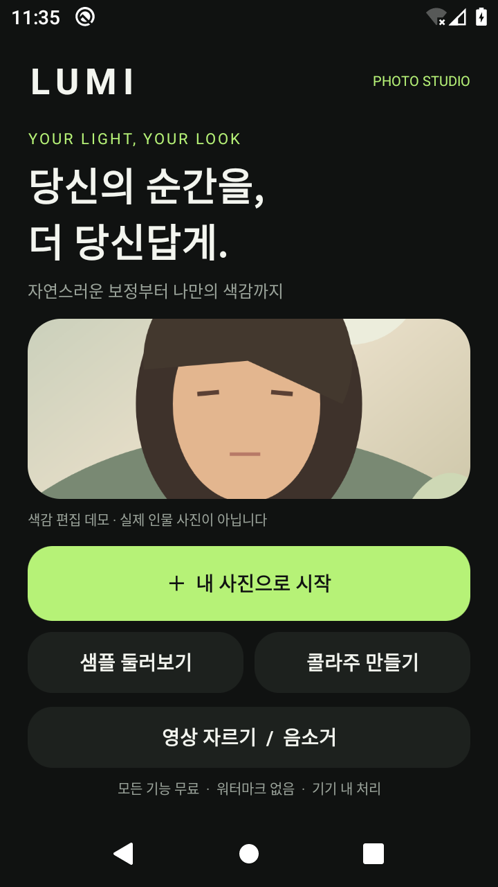
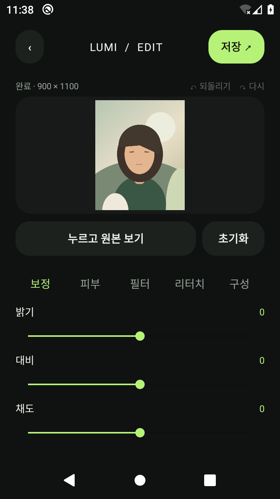

# LUMI — Android photo studio

안드로이드 사진·영상 편집 앱의 개발 중인 첫 버전입니다. 메이투를 참고한 독립 구현이며, 메이투의 코드·브랜드·유료 기능 잠금 해제를 사용하지 않습니다. 구현된 기능에는 결제, 광고, 워터마크, 계정이 없습니다. 인터넷 권한도 요청하지 않습니다.

## 모바일에서 확인하기

- [안드로이드 설치 APK 다운로드](https://github.com/MJY8647/JUNYOUNGWORK/raw/refs/heads/main/downloads/LUMI-debug.apk)
- [전체 코드 보기](app/src/main/java/com/junyoung/lumi)
- [구현 및 미구현 기능](FEATURES.md) · [검증 기록](VALIDATION.md)
- [Android 10 실행 검증 결과](docs/android-29-results.txt) · [Android 15 실행 검증 결과](docs/android-35-results.txt)

Android 10 이상에서 APK를 다운로드해 설치할 수 있습니다. 개발용 서명 버전입니다. iPhone에서는 코드와 화면을 볼 수 있지만 이 APK를 설치할 수 없습니다. 이 저장소는 앱 프로젝트와 결과물을 보관하며, Codex 대화 전체를 동기화하는 기능은 아닙니다.

| 홈 화면 | 사진 편집 화면 |
|---|---|
|  |  |

## 현재 사용 가능한 기능

- 시스템 파일 선택기로 사진 불러오기, EXIF 방향 처리, sRGB 변환
- 밝기, 대비, 채도, 색온도, 하이라이트 조절, 비네트
- 피부색 마스크와 경계 보존 양방향 필터를 사용하는 피부 스무딩
- 주변 색으로 작은 잡티를 메우는 브러시, 부위를 끌어 변형하는 브러시
- 강도 조절 가능한 선라이트·쿨 에어·필름·모노 필터
- 90도 회전, 좌우 반전, 중앙 비율 자르기(1:1, 4:5, 16:9)
- 문구와 화이트 프레임, 두 손가락 확대·이동
- 길게 눌러 원본 비교, 변경 이력 30단계 되돌리기·다시 실행, 전체 초기화
- 2~9장 콜라주: 그리드, 세로 스트립, 가로 스트립
- 영상 미리보기, 구간 자르기, 오디오 제거, MP4 내보내기
- 갤러리에 JPEG 품질 97 저장, 원본 파일 보존

**메이투 전체 기능이 구현된 것은 아닙니다.** 현재 안드로이드 버전과의 기능 대조 상태와 미구현 분야는 [FEATURES.md](FEATURES.md)를 확인하세요.

## 품질과 제한

사진은 긴 변 최대 4096px, 최대 약 600만 픽셀로 불러옵니다. 큰 원본은 메모리 사용을 줄이기 위해 축소됩니다. 미리보기는 긴 변 1100px이며 저장할 때 불러온 해상도로 다시 처리합니다. 콜라주 출력은 레이아웃에 따라 2000×2000, 2000×3000 이하, 또는 2000×1200입니다.

피부 스무딩은 얼굴 인식이나 AI가 아니라 피부색 추정입니다. 비슷한 색상의 배경에도 적용될 수 있으며, 조명·피부색에 따라 품질이 달라집니다. 잡티 브러시는 주변 평균색을 혼합하는 방식으로 복잡한 배경의 물체 제거를 지원하지 않습니다. 얼굴·몸 형태 도구는 사용자가 직접 조절하는 국소 변형입니다. 자르기는 중앙 정렬이며 자유 영역 이동은 미구현입니다.

영상 편집은 재인코딩하지 않는 remux 방식입니다. 시작점이 앞쪽 키프레임으로 이동할 수 있고, 끝점은 압축 프레임 경계로 제한됩니다. H.264/AAC MP4를 권장하며 다른 코덱의 지원은 기기에 따라 달라집니다. 영상 색감·피부 보정·자막·속도 변경은 아직 없습니다.

활동 중 화면 회전 시 사진과 편집 이력을 유지합니다. 운영체제가 앱 프로세스를 종료한 경우에는 편집 세션 복구가 아직 지원되지 않습니다. 결과를 먼저 저장하세요. 투명 이미지를 JPEG로 저장하면 투명도가 보존되지 않습니다.

## 개발 및 빌드

Android 10(API 29) 이상. Java 17 이상 JDK, Android SDK Platform 35와 Build Tools 35.0.0, Python 3가 필요합니다. 외부 앱 라이브러리는 없습니다.

Linux x86_64 클라우드에서는 `bash scripts/setup-cloud.sh`로 체크섬을 검증한 JDK·SDK를 설치하고 엔진 테스트와 APK 빌드를 실행할 수 있습니다. Android Studio 경로와 별도로 동작하는 직접 빌드 스크립트입니다.

```bash
export ANDROID_HOME=/path/to/android-sdk
export JAVA_HOME=/path/to/jdk
export PATH="$JAVA_HOME/bin:$PATH"
./scripts/test-engine.sh
./scripts/build-android.sh
```

출력: `build/native/LUMI-debug.apk`. 개발용 키로 서명합니다. 스토어 배포용 키가 아닙니다. Gradle/Android Studio용 프로젝트 파일도 포함되어 있습니다. Android Studio에서는 SDK 위치를 지정하고 프로젝트를 열 수 있습니다.

표준 Gradle 빌드: `./gradlew assembleDebug lintDebug`. 결과는 `app/build/outputs/apk/debug/app-debug.apk`입니다. 클라우드의 관리형 프록시와 인증서를 사용할 때는 `bash scripts/gradle-cloud.sh --no-daemon assembleDebug lintDebug`를 사용하세요. TLS 검증을 유지하고, 플랫폼 제공 인증서를 별도 truststore에 추가합니다. 두 빌드 방식은 동일한 개발용 서명 키를 사용합니다.

안드로이드 기기/에뮬레이터에서 `./scripts/test-android.sh`를 실행하면 실제 JPEG 불러오기·회전·콜라주 저장과 H.264 MP4 저장을 검증합니다. 테스트 파일 생성용 `ffmpeg`가 필요합니다. 파일 선택 결과 전달은 테스트에서 시뮬레이션하고, 디코딩·합성·갤러리 쓰기는 실제 플랫폼 API로 실행합니다.

현재 클라우드 설치 경로:

```bash
export ANDROID_HOME=/workspace/toolchains/android
export JAVA_HOME=/workspace/toolchains/jdk-21.0.8+9
export PATH="$JAVA_HOME/bin:$PATH"
cd /workspace/JUNYOUNGWORK
./scripts/test-engine.sh
./scripts/build-android.sh
```

## 개인정보

사진과 영상은 기기 안에서 처리됩니다. 서버 전송, 분석 SDK, 로그인, 결제 SDK가 없습니다. 선택한 파일만 읽고 결과를 `Pictures/LUMI` 또는 `Movies/LUMI`에 새 파일로 저장합니다. 원본을 수정하지 않습니다.
